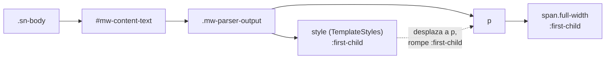

# Fix: el sangrado superior de `.full-width` no se dispara cuando hay TemplateStyles

## Objetivo

Hacer que la imagen-hero marcada como `.full-width` reviente también hacia
arriba (borde superior de la hoja) cuando es el primer elemento de flujo del
cuerpo, incluso en páginas cuyo contenido empieza con un `<style>` inyectado
por la extensión TemplateStyles.

El sangrado lateral ya funciona. Lo que falla es solo el sangrado vertical
superior (el bleed que come `--sn-paper-py` y redondea las esquinas de arriba).

## Diagnóstico

La regla del bloque "Bleed vertical de borde" exige que `.full-width` sea
`:first-child` en toda la cadena desde `.sn-body`. Cuando una plantilla usa
`<templatestyles>`, la extensión inyecta un `<style>` como **primer hijo** de
`.mw-parser-output`. Ese nodo ocupa el `:first-child`, así que el `<p>` que
envuelve la imagen pasa a ser el segundo hijo y la cadena de selectores se
rompe: la regla nunca matchea y el bleed superior no se aplica.

La cadena real del DOM en una ficha que arranca con imagen-hero es:



El sangrado lateral no sufre este problema porque su regla
(`:is(.sn-paper,.sn-canvas) :is(.full-width, …)`) no exige `:first-child`.

Nota: este fix corrige el skin a propósito y no la plantilla, porque el
sanitizador de TemplateStyles de esta wiki rechaza `var()` dentro de `calc()`,
de modo que la regla `margin-block-start: calc(-1 * var(--sn-paper-py))` no
puede vivir en `Plantilla:Obra/style.css`. El skin es el dueño natural del
sistema `.full-width`, y este arreglo beneficia a toda plantilla con hero.

## Cambio

Archivo: `resources/stella-nova.css`, bloque comentado "Bleed vertical de
borde" (la regla cuyo cuerpo es `margin-block-start: calc(-1 * var(--sn-paper-py))`
con los `border-*-radius` y `overflow: hidden`).

No se modifica la regla existente. Se **agrega** un set paralelo de selectores
que reconocen el `<style>` líder de TemplateStyles, reutilizando el mismo
cuerpo de declaraciones.

Insertar, justo después de la regla `:first-child` existente del bleed-top:

```css
/* Variante TemplateStyles: cuando el contenedor de contenido arranca con un
   <style> inyectado por <templatestyles>, ese nodo ocupa el :first-child y
   desplaza al <p> que lleva la imagen-hero, rompiendo la cadena :first-child
   de la regla de arriba. Reconocemos ese <style> líder con `style:first-child + *`
   para que el bleed-top igual se dispare cuando el primer elemento de flujo
   es una imagen .full-width. Mismo cuerpo de declaraciones que la regla base. */
.sn-body style:first-child + * > :is(.full-width, [class~="'full-width'"]):first-child {
	margin-block-start: calc(-1 * var(--sn-paper-py));
	border-start-start-radius: var(--sn-radius-paper);
	border-start-end-radius:   var(--sn-radius-paper);
	overflow: hidden;
}
```

El combinador descendiente `.sn-body … ` mantiene el alcance dentro del cuerpo;
`style:first-child + *` apunta al elemento inmediatamente posterior a un
`<style>` que es primer hijo de su contenedor (en la práctica, el `<p>` de la
ficha); y `.full-width:first-child` exige que la imagen sea lo primero dentro
de ese `<p>`. La triple condición evita disparar el bleed para imágenes que
estén a media página.

## Caveats

El selector cubre el caso de **un** `<style>` líder, que es el habitual:
TemplateStyles deduplica y suele emitir un único `<style>` por hoja. Si una
página usa varias plantillas con TemplateStyles, el contenedor puede arrancar
con varios `<style>` consecutivos y `style:first-child + *` apuntaría al
segundo `<style>`, no al `<p>`. Para blindar ese caso (opcional, requiere que
el target de navegadores soporte `:has()`, que el skin ya usa en otros
selectores) puede sumarse:

```css
.sn-body .mw-parser-output > p:first-of-type:has(> :is(.full-width, [class~="'full-width'"]):first-child) > :is(.full-width, [class~="'full-width'"]):first-child {
	margin-block-start: calc(-1 * var(--sn-paper-py));
	border-start-start-radius: var(--sn-radius-paper);
	border-start-end-radius:   var(--sn-radius-paper);
	overflow: hidden;
}
```

`p:first-of-type` ignora los nodos `<style>` (cuenta solo elementos `<p>`), y
el `:has()` confirma que ese primer párrafo realmente abre con una imagen-hero.

Recordatorio ya documentado en el bloque: en páginas con `<h1#firstHeading>`
visible el bleed-top superpone la imagen al título; las fichas que usan hero al
tope deben llevar `__NOTITLE__` (la plantilla Obra ya lo incluye).

## Verificación

1. Desplegar el skin y abrir una ficha de obra que arranque con imagen, por
   ejemplo `Sala de Música`.
2. La imagen debe tocar el borde superior, izquierdo y derecho de la hoja, con
   las esquinas superiores redondeadas al radio de la hoja.
3. Comprobar en el inspector que `span.full-width` tiene
   `margin-block-start` negativo (igual a `--sn-paper-py`) y `overflow: hidden`.
4. Verificar una página con imagen `.full-width` a media página (no primer
   elemento): no debe reventar hacia arriba.
